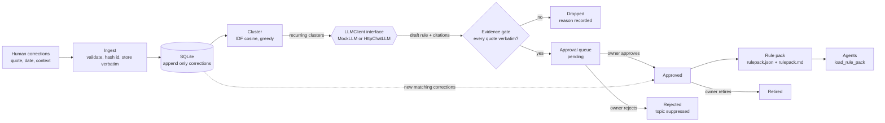

# correction-distiller

Agents get corrected by the people they work for, and then get corrected for the same thing again next week, because the correction lived in one chat and died there.
Letting the agent rewrite its own instructions fixes that and creates a worse problem: rules nobody approved, justified by things nobody said.

## What it does

A learning loop with a human owner in the middle.

1. **Ingest** human corrections. Each one needs the verbatim quote, the date it was said and the context the agent was working in. Records missing any of the three are refused, not patched.
2. **Cluster** corrections that say the same thing. A single correction is an incident; the same correction twice is a pattern.
3. **Draft** one proposed rule per recurring cluster. This is the LLM step. It sits behind an interface, with an offline mock for tests and the demo.
4. **Evidence or drop.** Every draft must cite its source quotes, and every cited quote is checked character for character against the stored correction. A paraphrased, misattributed or invented quote drops the whole draft and records why.
5. **Approval queue.** Surviving drafts wait as `pending`. A named human approves (optionally editing the text), rejects with a reason, or later retires a rule.
6. **Rule pack.** Only approved rules are exported to the file agents load. Each rule carries its quotes, dates, context, drafter and approver. The loader refuses a pack that fails its checksum or holds a rule with no approver or no evidence.

The drafter cannot approve its own work, a rejected topic is not drafted again when more corrections arrive, and new corrections on an approved topic are attached as extra evidence without touching the approved text.

## Architecture



| Module | Job |
| --- | --- |
| `ingest.py` | Validate records, content hash ids, dedupe, keep quotes exactly as given |
| `cluster.py`, `text.py` | Deterministic lexical clustering, no model needed |
| `llm.py` | `LLMClient` protocol, `MockLLM`, `HttpChatLLM`, prompt and reply parsing |
| `evidence.py` | The verbatim check that decides queue or drop |
| `pipeline.py` | One distill pass: propose, drop, reinforce, suppress |
| `review.py` | Approve, reject, retire; re-checks evidence at approval time |
| `rulepack.py` | Build, write, validate and render the pack |
| `store.py` | SQLite schema, including triggers that enforce the invariants in the database |
| `cli.py` | Command line front end |

Some guarantees are enforced twice, once in Python and once as SQLite triggers, so they hold even if a later script writes to the database directly: corrections cannot be updated or deleted, a proposal can only be inserted as `pending`, it cannot become `approved` with zero citations, approved text cannot change, and evidence cannot be removed from an approved rule.

## Run it

Python 3.10 or newer. No runtime dependencies, no API key.

```bash
python -m pip install -e ".[dev]"
python demo/run_demo.py
```

Day to day use is the CLI (state lives in `.distiller/distiller.db` unless `--db` or `CD_DB_PATH` says otherwise):

```bash
correction-distiller ingest demo/corrections_week1.jsonl
correction-distiller distill
correction-distiller queue
correction-distiller show <proposal-id>
correction-distiller approve <proposal-id> --by owner [--edit "Reworded rule."]
correction-distiller reject <proposal-id> --by owner --reason "Not a real pattern."
correction-distiller export --out rulepack
correction-distiller pack rulepack/rulepack.json --evidence
```

Other commands: `retire`, `dropped`, `log`. An agent loads the pack like this:

```python
from correction_distiller import load_rule_pack, render_prompt

pack = load_rule_pack("rulepack/rulepack.json")  # raises PackError on a bad pack
system_prompt += "\n\n" + render_prompt(pack)
```

Input is JSON Lines, one correction per line:

```json
{"quote": "Never text a customer after 8pm.", "date": "2026-03-03", "context": "sending appointment reminders", "agent": "front-desk-agent", "source": "chat review"}
```

### Using a real model

Copy `.env.example`, set `CD_LLM_PROVIDER=http` and the three `CD_LLM_*` values, and export them into the environment (the tool does not read `.env` files itself). `HttpChatLLM` posts to `{CD_LLM_BASE_URL}/chat/completions` with a bearer key. The evidence gate treats a real model exactly like the mock: untrusted until every quote checks out.

## Tests

```bash
python -m pytest
```

110 tests, all offline. They cover ingest validation, clustering, the verbatim check, the mock and HTTP clients (the HTTP client through a fake transport), the pipeline outcomes, review rules, the database triggers, pack tamper detection, the CLI end to end, and a check that `demo/output.txt` is byte for byte what the demo prints today. CI (`.github/workflows/ci.yml`) runs the tests and the demo on Linux and Windows.

## Demo

`python demo/run_demo.py` runs two weeks of invented corrections for an invented front desk agent. The captured output is in [`demo/output.txt`](demo/output.txt). What it shows:

- 16 records in, 2 refused (one has no date, one has a blank quote).
- 5 recurring clusters. Four drafts are queued. The fifth comes from a drafter that "tidied up" its quotes, and is dropped:

```
$ correction-distiller dropped
k_5c4748d29c0e  citation_not_verbatim  draft: 'Always check the crew calendar before offering a same day slot.'
  - c_a652a99e56d1: cited text is not a verbatim span of the source quote
  - c_d1530242ef59: cited text is not a verbatim span of the source quote
```

- An export before any review writes a pack with 0 rules.
- The drafter tries to approve its own proposal and is refused. The owner approves three (editing one) and rejects one.
- The exported pack lists 3 rules, each with its dated quotes.
- Week two: one duplicate is ignored, the price rule gains a citation, the rejected topic stays suppressed, and the crew calendar cluster (now changed) is drafted again with real quotes and waits for review.
- A rule appended to `rulepack.json` by hand makes the loader refuse the whole pack.

All data in the demo and tests is synthetic.

## Where this pattern runs

This is drawn from systems that run two small service companies day to day, where a handful of agents handle intake, scheduling and follow up and the owner corrects them in passing. The production version has the same shape: corrections captured with their exact wording, recurring ones distilled into candidate rules, and nothing reaching the agents' standing rules without the owner's sign off. This repository is a clean, self contained rewrite of that pattern with invented data.

## Limitations

- **Clustering is lexical.** It matches on shared stemmed words. Two corrections that mean the same thing in different vocabulary will not cluster, and two that share words but mean different things can. The threshold (`CD_SIMILARITY_THRESHOLD`, default 0.30) was tuned on short synthetic sentences, not on a real corpus. Swapping in embeddings would mean replacing `build_vectors` in `cluster.py`.
- **Clustering is greedy and re-run from scratch each pass.** Fine for hundreds or a few thousand corrections; it is quadratic in the worst case and was not built for more.
- **The gate checks quotes, not meaning.** It proves the cited words were said. It does not prove the rule follows from them. That judgement is the human reviewer's job, which is why the queue exists.
- **The mock drafter is a stand in.** It uses the shortest quote in the cluster as the rule text. That is enough to exercise the loop and sometimes produces a complaint rather than a rule (the demo rejects one of these). Real drafting quality depends on the model you plug in.
- **The HTTP client was not run against a live endpoint here.** Request building and reply parsing are tested through a fake transport only.
- **Reviewer identity is a name, not a login.** `--by owner` is checked against `CD_OWNERS` and against the drafter's name, nothing stronger. Anyone with shell access can type the owner's name.
- **The pack checksum is not a signature.** It catches hand edits and truncated files. Someone who can write the file can also recompute the hash.
- **Reinforcement adds evidence to approved rules automatically.** The approved text never changes, but the list of quotes under it grows without a second review.
- **Suppression is permanent in this version.** Once a topic is rejected or retired, later matching corrections are not drafted again; there is no "reconsider after N more" setting.
- **Single process, single file.** SQLite with no locking strategy beyond its defaults. No web UI; review happens in the terminal.

License: MIT, see the LICENSE file.
