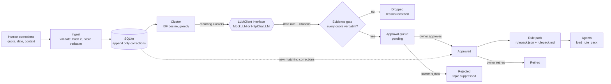

# correction-distiller

**Stops an AI agent from needing the same correction twice, without letting it write its own rules.**

If you supervise agents (front desk, scheduling, follow up, support), you know the loop. You tell the agent "never text a customer after 8pm", it complies in that chat, and next week it does it again, because the correction lived in one conversation and died there. Letting the agent rewrite its own instructions fixes that and creates a worse problem: rules nobody approved, justified by things nobody said.

This tool sits between the two:

- You feed it corrections as they happen: the exact words, the date, what the agent was doing.
- When the same correction shows up more than once, it drafts one proposed rule and shows you the quotes behind it.
- A draft whose quotes do not match what was actually said, character for character, is thrown out and the reason is recorded.
- Nothing reaches the agent until a named person approves it. Approved rules go into one file the agent loads, each rule carrying its quotes, dates and approver.

It is a small Python library and command line tool: standard library only, SQLite for state, 116 offline tests. The drafting step is an LLM behind an interface. What ships and is tested here is an offline mock drafter; the HTTP client for a real model has never been run against a live endpoint (see [Limitations](#limitations)).

## What you will see

Lines copied from `python demo/run_demo.py`, which runs two weeks of invented corrections for an invented front desk agent. `...` marks lines left out; the full capture is [`demo/output.txt`](demo/output.txt), and a test fails if this excerpt or that file drifts from what the demo prints.

```
$ correction-distiller distill
14 corrections, 7 clusters, 5 recurring: proposed 4, dropped 1, reinforced 0, suppressed 0, declined 0, errors 0, unchanged 0
...
  dropped k_5c4748d29c0e: citation_not_verbatim
...
$ correction-distiller approve p_0ece6a8b41 --by sloppy-llm
error: the drafter cannot review its own proposal
$ correction-distiller approve p_0ece6a8b41 --by owner
approved p_0ece6a8b41: Do not quote a price before the site visit is booked.
...
$ correction-distiller pack rulepack/rulepack.json --evidence
Standing rules (3), approved by a human owner:
1. Do not quote a price before the site visit is booked. [replying to a new estimate request]
   - 2026-03-02 (replying to a new estimate request): "Do not quote a price before the site visit is booked."
   - 2026-03-05 (replying to a new estimate request): "You quoted a price again before booking the site visit. Book the visit first."
   - 2026-03-11 (replying to a new estimate request): "No price quotes until the site visit is on the calendar."
...
(appended an unapproved rule to rulepack/rulepack.json by hand)
$ correction-distiller pack rulepack/rulepack.json
error: pack checksum mismatch; the file was edited or is incomplete
```

## How it works

1. **Ingest** human corrections from a JSON Lines file. Each one needs the verbatim quote, the date it was said and the context the agent was working in. Records missing any of the three are refused, not patched.
2. **Cluster** corrections that say the same thing. A single correction is an incident; the same correction twice is a pattern.
3. **Draft** one proposed rule per recurring cluster. This is the LLM step. It sits behind an interface, with an offline mock for tests and the demo.
4. **Evidence or drop.** Every draft must cite its source quotes, and every cited quote is checked character for character against the stored correction. A paraphrased, misattributed or invented quote drops the whole draft and records why.
5. **Approval queue.** Surviving drafts wait as `pending`. A named human approves (optionally editing the text), rejects with a reason, or later retires a rule.
6. **Rule pack.** Only approved rules are exported to the file agents load. Each rule carries its quotes, dates, context, drafter and approver. The loader refuses a pack that fails its checksum or holds a rule with no approver or no evidence.

The drafter cannot approve its own work, a rejected topic is not drafted again when more corrections arrive, and new corrections on an approved topic are attached as extra evidence without touching the approved text.

## Architecture



| Module | Job |
| --- | --- |
| `ingest.py` | Validate records, content hash ids, dedupe, keep quotes exactly as given |
| `cluster.py`, `text.py` | Deterministic lexical clustering, no model needed |
| `llm.py` | `LLMClient` protocol, `MockLLM`, `HttpChatLLM`, prompt and reply parsing |
| `evidence.py` | The verbatim check that decides queue or drop |
| `pipeline.py` | One distill pass: propose, drop, reinforce, suppress |
| `review.py` | Approve, reject, retire; re-checks evidence at approval time |
| `rulepack.py` | Build, write, validate and render the pack |
| `store.py` | SQLite schema, including triggers that enforce the invariants in the database |
| `cli.py` | Command line front end |

Some guarantees are enforced twice, once in Python and once as SQLite triggers, so they hold even if a later script writes to the database directly: corrections cannot be updated or deleted, a proposal can only be inserted as `pending`, it cannot become `approved` with zero citations, approved text cannot change, evidence cannot be removed from an approved rule, and a stored citation cannot be rewritten. The triggers guard against mistakes, not against someone with write access to the file, who can drop them.

## Run it

Python 3.10 or newer. No runtime dependencies, no API key. In a virtual environment:

```bash
python -m pip install -e ".[dev]"
python demo/run_demo.py
```

Day to day use is the CLI (state lives in `.distiller/distiller.db` unless `--db` or `CD_DB_PATH` says otherwise):

```bash
correction-distiller ingest demo/corrections_week1.jsonl
correction-distiller distill
correction-distiller queue
correction-distiller show <proposal-id>
correction-distiller approve <proposal-id> --by owner [--edit "Reworded rule."]
correction-distiller reject <proposal-id> --by owner --reason "Not a real pattern."
correction-distiller export --out rulepack
correction-distiller pack rulepack/rulepack.json --evidence
```

Other commands: `retire`, `dropped`, `log`. `python -m correction_distiller` is the same entry point. With the default mock drafter, `distill` on the week one file proposes five rules and drops none; the drop in the demo comes from a deliberately sloppy drafter defined in `demo/run_demo.py`. An agent loads the pack like this:

```python
from correction_distiller import load_rule_pack, render_prompt

pack = load_rule_pack("rulepack/rulepack.json")  # raises PackError on a bad pack
system_prompt += "\n\n" + render_prompt(pack)
```

Input is JSON Lines (UTF-8), one correction per line. `agent` and `source` are optional:

```json
{"quote": "Never text a customer after 8pm.", "date": "2026-03-03", "context": "sending appointment reminders", "agent": "front-desk-agent", "source": "chat review"}
```

### Using a real model

Copy `.env.example`, set `CD_LLM_PROVIDER=http` and the three `CD_LLM_*` values, and export them into the environment (the tool does not read `.env` files itself). `HttpChatLLM` posts to `{CD_LLM_BASE_URL}/chat/completions` with a bearer key. The evidence gate treats a real model exactly like the mock: untrusted until every quote checks out. This path is unit tested through a fake transport and has not been run against a live endpoint.

## Tests

```bash
python -m pytest
```

116 tests, all offline. They cover ingest validation, clustering, the verbatim check, the mock and HTTP clients (the HTTP client through a fake transport), the pipeline outcomes, review rules, the database triggers, pack tamper detection, the CLI end to end, a check that `demo/output.txt` is exactly what the demo prints today, and a check that the excerpt at the top of this file is taken from it. CI (`.github/workflows/ci.yml`) runs the tests and the demo on Linux and Windows, Python 3.10 and 3.12.

## Demo

`python demo/run_demo.py` runs two weeks of invented corrections for an invented front desk agent. The captured output is in [`demo/output.txt`](demo/output.txt). What it shows:

- 16 records in, 2 refused (one has no date, one has a blank quote).
- 5 recurring clusters. Four drafts are queued. The fifth comes from a drafter that "tidied up" its quotes, and is dropped:

```
$ correction-distiller dropped
k_5c4748d29c0e  citation_not_verbatim  draft: 'Always check the crew calendar before offering a same day slot.'
  - c_a652a99e56d1: cited text is not a verbatim span of the source quote
  - c_d1530242ef59: cited text is not a verbatim span of the source quote
```

- An export before any review writes a pack with 0 rules.
- The drafter tries to approve its own proposal and is refused. The owner approves three (editing one) and rejects one.
- The exported pack lists 3 rules, each with its dated quotes.
- Week two: one duplicate is ignored, the price rule gains a citation, the rejected topic stays suppressed, and the crew calendar cluster (now changed) is drafted again with real quotes and waits for review.
- A rule appended to `rulepack.json` by hand makes the loader refuse the whole pack.

All data in the demo and tests is synthetic.

## Background

The pattern comes from the author's own agent setup for small service businesses, where a few agents handle intake, scheduling and follow up and the owner corrects them in passing. None of that system or its data is in this repository, and nothing here is evidence of how it performs. This is a self contained rewrite of the idea with invented data.

## Limitations

- **The only drafter that has been run is the mock.** It uses the shortest quote in the cluster as the rule text. That is enough to exercise the loop and sometimes produces a complaint rather than a rule (the demo rejects one of these). No real model has drafted a rule through this code, so drafting quality and how often a real model fails the verbatim check are unknown.
- **The HTTP client has never called a live endpoint.** Request building and reply parsing are tested through a fake transport only. Expect to adjust it for your provider (no retries, no rate limit handling, no streaming).
- **There is no capture step.** Nothing here listens to a chat tool, inbox or ticket system. Someone, or another script, has to write each correction to a JSON Lines file with its exact wording, date and context.
- **Clustering is lexical.** It matches on shared stemmed words. Two corrections that mean the same thing in different vocabulary will not cluster, and two that share words but mean different things will. Negation words are ignored, so "Always text the customer after the visit" and "Never text the customer after the visit" land in one cluster and are drafted as one rule. The reviewer sees both quotes, but the tool does not flag the conflict. The threshold (`CD_SIMILARITY_THRESHOLD`, default 0.30) was tuned on short synthetic sentences, not on a real corpus. Swapping in embeddings would mean replacing `build_vectors` in `cluster.py`.
- **Not benchmarked.** It has only been run on the demo (17 stored corrections) and the test fixtures. Clustering is greedy, re-run from scratch on every pass, and compares each correction with every cluster so far, so cost grows roughly with the square of the input.
- **The gate checks quotes, not meaning.** It proves the cited words were said. It does not prove the rule follows from them. That judgement is the human reviewer's job, which is why the queue exists.
- **Reviewer identity is a name, not a login.** With `CD_OWNERS` unset, any name other than the drafter's can approve. With it set, `--by` must be on the list. Either way anyone with shell access can type the owner's name.
- **The pack checksum is not a signature.** It catches hand edits and truncated files. Someone who can write the file can also recompute the hash.
- **Reinforcement adds evidence to approved rules automatically.** The approved text never changes, but the list of quotes under it grows without a second review, and it grows with whatever the clusterer decided belongs to that topic.
- **Suppression is permanent in this version.** Once a topic is rejected or retired, later matching corrections are not drafted again; there is no "reconsider after N more" setting.
- **Identical wording on the same day is one correction.** Ids are a hash of quote, date, context and agent, so the same sentence said twice in one day in the same context counts once.
- **Single process, single file.** SQLite with no locking strategy beyond its defaults. No web UI; review happens in the terminal.

License: MIT, see the LICENSE file.
